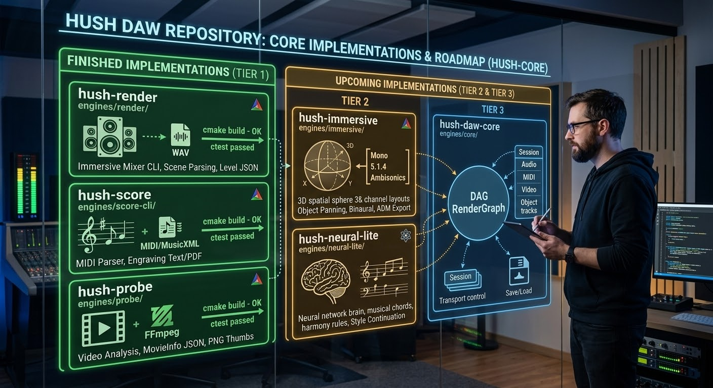

# hush-core (Hush Audio Workstation)

[](https://opensource.org/licenses/MIT)
[](https://en.cppreference.com/w/cpp/17)
[]()

> A modern, high-performance, zero-telemetry C++17 audio engine and modular digital audio workstation workspace.

---

## 📖 Overview

**hush-core** is an advanced audio workstation repository engineered with clean C++17 architecture, native GUI implementations, and privacy-first zero-telemetry design principles. It provides a modular framework incorporating dedicated engines for immersive audio mixing, MIDI notation, plugin hosting, video probing, neural composition assistance, and session core routing.

---

## 🗺️ Repository Architecture & Roadmap

[span_0](start_span)[span_0](end_span)

---

## 🛠️ Completed Core Builds (Tier 1)

The repository successfully implements the first foundational wave of build targets:

1. **`hush-render` (`engines/render/`)**
   * **Target:** Immersive mixer CLI (`hush-render`) and static library (`hush_render`).
   * **Features:** Plain-text scene file parsing, custom std::-only PCM/float32 WAV reader, object-based panning via `hush::immersive`, and speaker level JSON output generation.

2. **`hush-score` (`engines/score-cli/`)**
   * **Target:** MIDI to MusicXML to engraved score CLI (`hush-score`) and static library (`hush_score_cli`).
   * **Features:** Built-in std::-only Standard MIDI File (SMF) parser, tempo map/time signature extraction, MusicXML 3.1 export, and optional LilyPond PDF integration.

3. **`hush-probe` (`engines/probe/`)**
   * **Target:** Video probe and thumbnail extractor CLI (`hush-probe`) and static library (`hush_probe`).
   * **Features:** FFmpeg video integration, strict MovieInfo JSON serialization, and a custom std::-only PNG thumbnail writer across timeline markers.

---

## 🚀 Getting Started & Build Instructions

### Prerequisites
Ensure your build environment satisfies the following requirements:
* CMake 3.16 or higher
* A C++17 compliant compiler with `-Wall -Wextra` support
* Optional: FFmpeg development headers (for video features)

### Compilation

Clone the repository and build the workspace using CMake:

```bash
git clone [https://github.com/ljrseals-dev/hush-core.git](https://github.com/ljrseals-dev/hush-core.git)
cd hush-core
cmake -S . -B build
cmake --build build
